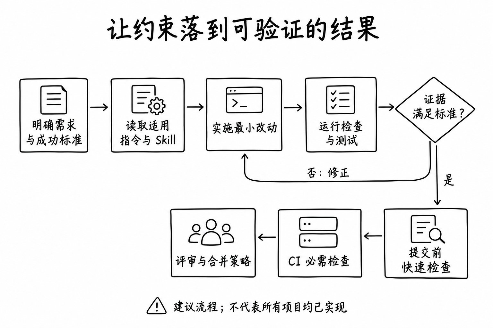

使用 AI 写代码时，最耗时间的部分往往发生在第一版代码之后：提醒它不要重构无关模块，纠正过时的组件 API，要求补充边界测试，再追问一句“你真的跑过了吗”。

这些提醒如果每次都靠人重复，Agent 的效率就很难稳定。一个更有效的做法，是把团队的工作方法写进仓库，再把能执行的检查接入工具链，让每项任务都有明确的完成标准。

我在一个 Bun 与 Turborepo Monorepo 中看到了一套值得借鉴的设计：根目录规定工作流程，模块指令记录业务契约，Skill 提供专项方法，提交钩子执行格式和静态检查。这些机制组合起来，使 Agent 更容易主动检查、补充必要的测试，并交付可复核的结果。

本文从这套实践提炼一份通用方案。核心目标是：**减少重复解释、无关修改和验证返工，同时让每一次“已完成”都能对应到证据。**

## 一、明确每一层负责什么

把所有要求堆进一份长提示词，会使通用规则、业务细节和临时需求混在一起。更容易维护的结构，是按适用范围拆分。

| 层级 | 放什么 | 主要解决的问题 |
| --- | --- | --- |
| 仓库入口 | 项目地图、工作流程、真实命令、变更边界 | Agent 从哪里开始，怎样才算完成 |
| 模块指令 | 权限、状态转换、数据归属、跨服务契约 | 哪些业务前提不能猜 |
| 专项 Skill | 触发条件、步骤、参考资料、输出要求 | 这类任务具体怎么做 |
| 工程门禁 | 格式检查、类型检查、测试、构建、分支保护 | 哪些错误必须由机器拦截 |
| 任务证据 | 检查命令、结果、验收记录、未验证范围 | 如何判断本次交付可信 |

[AGENTS.md](https://agents.md/) 提供面向编码 Agent 的项目指令入口，也支持在子项目中放置更具体的说明。不同工具对文件发现、指令优先级和上下文加载的实现可能不同，接入时需要验证实际行为，不能只因为文件存在就认为它已经生效。

一个可迁移的目录示例如下。这是组织方式示例，具体技能目录需要适配所用客户端。

```text
repository/
├── AGENTS.md
├── apps/
│   └── web/
│       └── AGENTS.md
├── packages/
│   └── ui/
│       └── AGENTS.md
├── .agents/
│   └── skills/
│       ├── code-conventions/
│       │   └── SKILL.md
│       ├── regression-check/
│       │   ├── SKILL.md
│       │   └── references/
│       └── acceptance-guide/
│           └── SKILL.md
└── scripts/
    └── check-changed-files.mjs
```

共享规范保留一份正本，再通过客户端支持的引用或链接方式接入。尤其要在 Windows 和 CI 检查符号链接是否正常解析，避免某个工具实际上只读到一行路径。

## 二、根指令先规定验证闭环

案例仓库中，一条最有价值的规则是：

> 动手前先定义可验证的成功标准，完成修改后执行检查，失败则继续修复。

这条规则改变了 Agent 对“完成”的理解。写完函数只是中间状态；证明函数满足要求，才构成交付。

例如“修复保存设置失败”的成功标准，可以先写成：有效输入保存后刷新仍然存在；无效输入不能提交；服务端拒绝时保留草稿并显示错误。后续再为这些标准选择测试与验收方式。

下面是一份精简的根指令模板。命令部分必须换成仓库中实际存在的脚本，不能照抄一个不存在的 `test` 命令。

```markdown
# Repository Agent Guide

## Scope
- Read the affected workspace guide before editing.
- Preserve unrelated working-tree changes.
- State material assumptions and resolve contract ambiguity before implementation.

## Workflow
- Define observable success criteria before changing code.
- Make the smallest change that satisfies those criteria.
- Select checks based on the changed behavior and its risk.
- Run the checks, fix failures caused by this change, and rerun affected checks.
- Report environmental blockers and existing failures separately.

## Verification
- Use commands defined in the repository scripts and CI configuration.
- Add a regression test when a reproducible behavioral defect warrants one.
- Check user-facing interactions when static checks cannot prove the behavior.
- Never report a check as passed unless it was actually executed successfully.

## Delivery
- Summarize behavior changes, verification results, and remaining limitations.
- Keep commits focused and use the agreed branch workflow.
- Publish or deploy only within the user's authorized scope.
```

这份模板没有要求每次运行全仓测试，也没有要求每次新建测试文件。纯文案修改和权限系统修改的验证成本应当不同。好的规则需要明确目标，也要保留按风险选择方法的空间。

## 三、模块指令记录不能从代码表面判断的契约

模块文件最值得记录的是那些“看起来可以这样改，实际却会破坏约定”的事情。

例如，一个异步任务接口返回成功，可能只代表接受了暂停请求，并不代表任务已经停止。Agent 如果把 HTTP 成功直接映射成“已暂停”，页面就会出现虚假的完成状态。

可以把这类经验写成具体规则：

```markdown
# Job Control Contract

- A successful pause response acknowledges the request, not the final state.
- Read the authoritative job state until the transition settles.
- Do not infer completion from a failed status request.
- Verify pause and resume with disposable jobs and read back their final states.
```

案例仓库就有类似要求：验证后端控制能力时，必须真实执行控制操作并读取结果；只查询列表不足以证明暂停、恢复、取消有效。

相较于“注意异步问题”，这样的规则同时给出了事实、禁止的推断和验证方式。

另一个典型问题是技术栈版本。案例仓库要求写框架和组件代码前查看对应版本的本地文档或类型定义，避免模型套用训练中更熟悉的旧 API。通用做法是让依赖清单、锁文件和已安装类型成为依据，把版本号留在它们的权威位置，减少多份文档同时维护版本的负担。

模块文件也需要控制长度。某条内容只影响一个子目录时，应考虑下沉；可直接从代码查到的长篇文件清单，应考虑删除或改成入口链接。

## 四、把 Skill 设计成有输入输出的流程

[Agent Skills 规范](https://agentskills.io/specification) 将 Skill 组织为包含 `SKILL.md` 的目录，通过 `name` 和 `description` 描述名称与用途，并允许附带脚本、参考资料和资源。

文件格式只是起点。一项容易复用的技能，至少需要说明以下内容。

| 要素 | 应回答的问题 |
| --- | --- |
| 触发条件 | 什么请求应该使用它，什么请求不应该使用它 |
| 输入依据 | 先读需求、diff、业务契约，还是已有测试 |
| 执行步骤 | 如何从输入得到结果 |
| 完成标准 | 用什么证据说明流程完成 |
| 失败处理 | 环境缺失、结果不确定时如何继续或报告 |
| 操作边界 | 能否改文件、发评论、提交、推送或部署 |

下面是一个回归验证技能的示例。它提炼了案例中的验证思路，并不是案例仓库现有技能的原文。

```markdown
---
name: regression-check
description: Validate behavioral fixes with focused regression checks. Use for reproducible bugs in logic, state, permissions, or API handling; not for copy-only edits.
---

# Regression Check

1. Read the requirement, affected diff, nearest guide, and existing test setup.
2. Describe the observable failure and expected behavior.
3. Reproduce the failure when the environment permits it.
4. Add the smallest test that distinguishes the broken and fixed behavior.
5. Run the focused test and relevant static checks.
6. Check affected interactions if unit tests cannot prove the user-visible result.
7. Report commands, outcomes, and any unverified behavior.

Do not invent a runner or install a new framework just to satisfy this workflow.
Do not weaken an assertion merely to make the test pass.
If reproduction is blocked, describe the blocker instead of claiming a regression was proven.
```

触发条件应包含排除项。例如，人工验收指南适用于“如何交给产品和 QA 测试”，并不等于“为代码新增单元测试”。边界清楚，Agent 才不容易在简单任务中启动过大的流程。

Skill 也不需要写入所有参考资料。常用步骤放在正文，复杂场景的说明放在 `references/`，重复且确定的操作放进脚本。让 Agent 按任务读取，比每次加载全部知识更容易控制成本。

## 五、按风险选择验证方式

“增加测试”本身不能证明质量提高。测试必须对准可能出错的行为，而且能区分正确与错误的实现。

| 改动类型 | 优先验证的内容 | 通常适合的方式 |
| --- | --- | --- |
| 文案与静态内容 | 内容、链接、页面能否生成 | 内容校验、构建或页面预览 |
| 纯函数与转换逻辑 | 正常输入、边界值、异常输入 | 聚焦的单元测试 |
| 表单与交互状态 | 输入、提交、失败恢复、刷新 | 逻辑测试加浏览器验证 |
| API 与持久化 | 请求响应契约、错误映射、实际保存 | 集成测试与结果回读 |
| 权限与多租户 | 授权范围、拒绝路径、隔离性 | 正反向权限测试 |
| 依赖与构建配置 | 受影响消费者是否仍然可用 | 类型检查、构建与关键流程冒烟 |

这些是起点，不是互斥分类。涉及权限的表单，需要同时验证交互和访问控制。

以“快速连续保存设置后，旧请求覆盖了新选择”为例，一项有价值的测试应该控制两个请求的完成顺序，先返回新请求，再返回旧请求，最后断言用户看到的仍是最新选择。只测试一次成功保存，就没有覆盖这次缺陷。

如果环境允许，应确认测试在旧实现上失败、修复后通过。做这件事时可以使用隔离工作区或受控替换，不能为了展示红绿变化而覆盖用户的未提交修改。

还应区分三类证据：

- **静态检查通过**：说明代码满足相应的语法、类型或规则约束。
- **自动化测试通过**：说明指定场景中的断言成立。
- **人工或浏览器验收通过**：说明实际检查过的页面行为符合预期。

它们各自覆盖不同范围。构建成功不能证明权限正确，一张截图也不能证明保存后刷新仍然存在。

案例仓库中的人工验收技能要求写清入口、角色、操作、预期结果和清理步骤，并区分“已验证”与“建议验证”。这使验收说明可以直接交给别人执行，也限制了 Agent 夸大验证范围。

## 六、用工程门禁承接确定性规则

文字约束影响 Agent 的决策；工程检查负责对具体结果作出可重复判断。

案例仓库通过 Lefthook 在提交前调用 Biome 检查暂存文件。这提供了即时反馈，但该钩子本身没有执行所有测试或类型检查。因此，“有提交钩子”和“有完整质量门禁”不能画等号。

下面是一种可逐步建立的流程，其中 CI 必检和分支保护是通用方案的建议层，不代表案例已经实现了所有环节。



适合机器判断的规则，例如格式、类型、测试退出码、禁止的依赖关系，应尽量进入脚本或 CI。需要业务判断的规则，例如“这个状态是否能视为完成”，则由契约、测试和评审共同覆盖。

本地钩子仍可能缺失或被跳过，关键要求应在 CI 再执行，并通过代码托管平台的合并策略要求检查通过。涉及密钥、生产权限和外部发布的边界，则还需要执行环境与权限系统支持，不能只依赖 Markdown 中的一句禁止。

门禁的颗粒度同样影响效率：本地优先提供快速反馈，CI 根据依赖关系运行必要检查。不要让一次标题修改承担与数据库迁移相同的验证成本。

## 七、用证据评估约束是否成熟

规则数量和 Skill 数量都不是成熟度指标。我更建议检查一套规则是否能在真实任务中稳定改变行为。

下面是一份团队自评量表，属于实践建议，不是行业认证标准。每项 0 至 2 分，总分 16 分。

| 维度 | 0 分 | 1 分 | 2 分 |
| --- | --- | --- | --- |
| 入口与加载 | 不知道读取哪些指令 | 有文档但发现方式不稳定 | 代表任务中能稳定读取正确范围 |
| 命令可执行性 | 命令缺失或失效 | 依赖个人环境或口头补充 | 按文档准备后可重复执行 |
| 变更边界 | 经常修改无关内容 | 有范围规则但仍常需纠正 | 能保留既有修改并控制 diff |
| 业务契约 | 只有泛泛提醒 | 部分契约具体化 | 关键权限和状态契约有反向验证 |
| 测试有效性 | 无验证或只测表面 | 有断言但不覆盖主要风险 | 测试能识别目标缺陷和边界 |
| 交付证据 | 宣称通过却无记录 | 有记录但范围含糊 | 命令、结果和未验证范围对应清楚 |
| 工程执行 | 完全依赖提示词 | 本地有自动检查 | 必需检查接入 CI 和合并策略 |
| 维护与回放 | 规则持续堆积 | 偶尔清理 | 定期回放任务并修正失效规则 |

可以把 0 至 5 分看作起步，6 至 10 分看作已形成流程，11 至 13 分看作基本可重复，14 至 16 分看作进入持续评估。分段只是讨论工具，团队需要结合自己的风险调整。

另外设置几条不能被总分抵消的底线：伪造测试通过、擅自执行未授权的发布、破坏用户已有改动、泄露凭据。出现这些问题时，应先处理原因，不能靠其他维度的高分宣布成熟。

### 用任务回放校准评分

选择一组代表性任务，例如逻辑修复、权限修复、UI 交互、跨包改动和文案修改。固定起始提交、需求、工具权限和验证环境，分别在现有规则和候选规则下运行；尽量保持模型与配置一致，每类重复多次，避免用一次成功下结论。

评估时，除了观察 Agent 有没有遵守步骤，还要保留独立验收。Agent 自己写的测试可能与错误实现共享同一假设，不能成为唯一裁判。

| 指标 | 建议记录方式 |
| --- | --- |
| 首次验收通过率 | 无需人工修正即可通过独立验收的任务数 ÷ 已完成任务数 |
| 人工干预次数 | 每个任务需要纠正方向、补充约束或追问验证的次数 |
| 总交付耗时 | 从任务开始到验收通过，包含等待、重试和返工 |
| 无关变更比例 | 评审认定无关的改动文件数 ÷ 总改动文件数，同时查看 diff |
| 验证成本 | 检查耗时、重复运行次数与工具调用成本 |
| 交付后回归 | 固定观察窗口内确认由变更引入的问题数，并标注严重度 |

不要单独优化某一项。干预减少但回归增加，可能只是漏检；耗时下降但检查被跳过，也不能算效率提高。只有质量不下降、总成本降低，才能支持“这套约束让 AI Coding 更高效”的结论。

## 八、维护规则时同样坚持最小改动

最容易出现的退化，是每发现一个问题就追加一段提示词，最后根指令变成历史问题汇总。

每次增加规则之前，可以先问：

1. 这是长期有效的契约，还是本次任务的临时偏好？
2. 它能否通过测试、类型或 lint 更可靠地表达？
3. 它应影响整个仓库，还是只影响某个模块？
4. 是否已经有同义或相互冲突的规则？
5. 用什么任务能证明新增规则有效？

案例仓库要求仅在持久约束变化时更新指令，不把日常 UI 调整和普通修复写成规则日志。这是值得保留的维护原则。

现有实践也会有不一致。例如，模块指南仍可能写着“没有配置测试运行器”，而代码里已经出现使用 `bun:test` 的测试文件。此时应核对实际运行方式，修正文档并明确测试入口；不能因为存在测试文件，就推断 CI 已经会运行它们。

迁移到自己的项目时，也不必复制案例中的框架版本、包管理器、分支名称和业务流程。应该迁移的是“依据在哪里、行为怎样验证、结果如何交付”这套结构。

## 九、从最小可用方案开始落地

第一次建立这套体系，可以按以下顺序推进。

1. **盘点真实命令。** 确认安装、格式、类型、测试和构建分别如何执行，记录环境前提。
2. **建立简短根指令。** 写清成功标准、变更边界、验证循环和交付证据。
3. **补充高风险模块契约。** 优先覆盖权限、状态机和跨服务边界，不追求一次写全。
4. **提取反复发生的专项流程。** 先做少量高频 Skill，例如回归验证、验收指南和 PR 整理。
5. **接入确定性检查。** 本地快速反馈，CI 承接必须通过的检查。
6. **回放代表任务。** 用结果决定增加、修改还是删除规则。

一次交付可以用很短的记录结束：改了什么行为，运行了什么检查，结果如何，还有哪些范围未验证。记录不需要复杂，但必须与实际执行一致。

成熟的 Agent 约束会让团队越来越少地重复提醒，也让评审者越来越容易判断结果是否可靠。把规则写成可执行的方法，把完成标准落实为证据，再用真实任务持续检验，这套机制才会随着项目一起成长。
