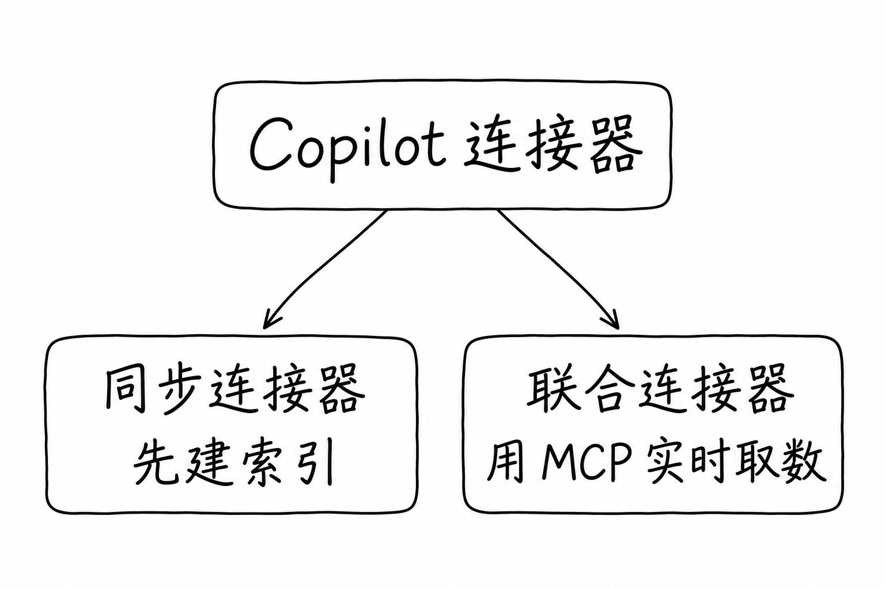

在 AI 产品里点下「连接 GitHub」，选好仓库，页面显示「已连接」。这时更值得问的是：**它能读哪些内容，又能做哪些操作？**

上一篇[《别再混淆 Skill、MCP 和 Function Calling 了》](../skill-mcp-function-calling/)讲了工具如何被发现、调用和组织。这次从产品里的「连接」按钮说起。

## 连接器和 MCP 有什么区别？

**连接器解决「在这个产品里，怎样用上 GitHub？」MCP 解决「客户端和提供工具的服务器，怎样互相通信？」** 连接器把账号连接、访问范围和可用操作做进产品里。MCP 规定客户端怎样发现服务器提供的能力、发请求和接收结果。 [MCP 架构说明](https://modelcontextprotocol.io/docs/learn/architecture) · [MCP 授权规范](https://modelcontextprotocol.io/specification/latest/basic/authorization)

| 对比维度 | 连接器（产品集成） | MCP（通信协议） |
| --- | --- | --- |
| 怎么接入 | 在产品里启用集成，按需登录并选择仓库或文件等范围 | 直接接入时，在支持 MCP 的客户端填写远程服务地址，或配置本地启动命令 |
| 授权管什么 | 授权某个集成访问指定数据，范围受产品设置和源账号权限限制 | HTTP 接入可使用标准授权流程，具体能访问哪些数据仍由服务和授权决定 |
| 能读还是能写 | 看产品对这个服务开放了哪些功能，比如只读搜索或创建事项 | 看服务器提供了哪些工具，以及客户端配置和账号权限允许哪些调用 |
| 数据怎么来 | 可以按需查询外部系统，也可以先同步建索引再搜索 | 统一请求和结果的格式，查源系统或查索引由服务器实现决定 |
| 换个 AI 产品还能用吗 | 看新产品有没有相应的集成，以及它开放了哪些能力 | 兼容的客户端可以连接同一个 MCP Server，再按需授权和启用工具 |

## 同样接 GitHub，为什么能做的事不同？

在 ChatGPT 里启用 GitHub 集成时，你到 GitHub 授权并选择仓库，之后可以按需搜索和读取仓库内容。这个集成提供只读访问。OpenAI 的文档把这类集成称为 connected apps。 [OpenAI 的应用说明](https://help.openai.com/en/articles/11487775-connected-apps-in-chatgpt) · [GitHub 接入说明](https://help.openai.com/en/articles/11145903-connecting-github-to-chatgpt)

接入 GitHub 官方 MCP Server 时，客户端可以发现查询 PR（Pull Request）的工具。服务器也提供创建 PR 的工具，能否调用还要看工具是否启用、客户端是否允许以及 GitHub 是否授予了写权限。做博客周报时，真正需要核对的是当前接入能否查到 PR 和合并时间。 [GitHub 官方 MCP Server](https://github.com/github/github-mcp-server)

## 一个连接器是怎么做出来的？

假设要做一个 GitHub 周报连接器，第一版只提供「查询已合并的 PR」。开发时要做四件事。

1. **定义操作。** 写清用途和参数。这个查询接收仓库和日期范围，返回 PR 的标题、标签、合并时间和链接。
2. **接好授权。** 例如用 GitHub App 取得所选仓库的 PR 只读权限。调用时检查目标仓库是否在授权范围内。 [GitHub PR 接口文档](https://docs.github.com/en/rest/pulls/pulls#list-pull-requests)
3. **实现查询。** 后端分页读取 GitHub 的 PR 接口，按合并时间筛选，再把结果整理成约定的格式。空结果和授权失败要让产品能区分开。
4. **注册到产品。** 在目标 AI 产品里注册操作和授权方式，接入产品的账号连接流程。分别用已授权和未授权的仓库测试一次。

注册方式取决于产品。**Power Platform** 可以用 OpenAPI 描述现有 REST API 的操作和参数，再注册成自定义连接器。在 **Claude** 里，可以填写已有远程 MCP Server 的地址、配置授权，再把它添加为连接器。如果需要自己开发这个 Server，就把查询做成一个 MCP 工具，由工具调用 GitHub API。 [Power Platform 自定义连接器](https://learn.microsoft.com/en-us/connectors/custom-connectors/) · [Claude 自定义连接器](https://support.claude.com/en/articles/11175166-get-started-with-custom-connectors-using-remote-mcp) · [MCP Server 开发指南](https://modelcontextprotocol.io/docs/develop/build-server)

如果做的是文档搜索，开发时还要决定数据怎么进产品。以 Microsoft 365 Copilot 为例，同步连接器先把数据写入搜索索引，联合连接器通过 MCP 实时取数。 [Microsoft 365 Copilot 连接器文档](https://learn.microsoft.com/en-us/microsoft-365/copilot/connectors/overview)

*Microsoft 365 Copilot 连接器取数方式示意图。*

## 拿到 PR 清单之后，Skill 做什么？

一份周报得先定口径。比如按合并时间统计过去七天的 PR，按功能、修复和文档分组，每条都附原始链接。每周都用这套规则，就可以把它们写进一个周报 Skill。Agent Skills 规范用 `SKILL.md` 保存指令，也允许把模板、参考资料和脚本放在一起。 [Agent Skills 规范](https://agentskills.io/specification)

你贴一份带合并时间的 PR 清单，Skill 就能按这套规则整理。要让 Agent 自己去 GitHub 取数，则需要能查到这些字段的工具和相应授权。

## 按场景怎么选？

| 场景 | 怎么选 |
| --- | --- |
| 想让 AI 搜索仓库代码，产品自带的 GitHub 集成已经能搜 | **用现成连接器。** 选好授权仓库，用一个已知文件验证能否搜到。 |
| 现有 GitHub 集成查不到合并时间，有兼容的 MCP Server 提供这个字段 | **接现成的 MCP Server。** 按当前客户端的要求授权，用一条已合并的 PR 核对返回结果。 |
| 内部工单系统只有 REST API，要接进团队正在用的 AI 产品 | **开发自定义连接器。** 先确认产品支持的接入方式，再实现查询和账号授权。 |
| 同一套工单查询要给多个支持 MCP 的 AI 客户端用 | **复用或开发一个 MCP Server。** 在各客户端接入，再配置各自的授权。 |
| 想把内部知识库纳入公司现有的统一搜索 | **选支持索引同步的连接器。** 确认哪些内容会被索引，以及源系统权限怎样同步。 |
| PR 已经能查到，团队每周要按同一口径写周报 | **沿用现有接入，加一个 Skill。** 固定日期范围、分组和链接格式。 |

## 总结

**连接器把外部服务的账号授权、数据访问和操作接进 AI 产品。** 判断一个连接器是否合适，先确认它能访问哪些数据、能执行哪些读写操作，再看数据是按需读取，还是同步到索引后供产品搜索。
