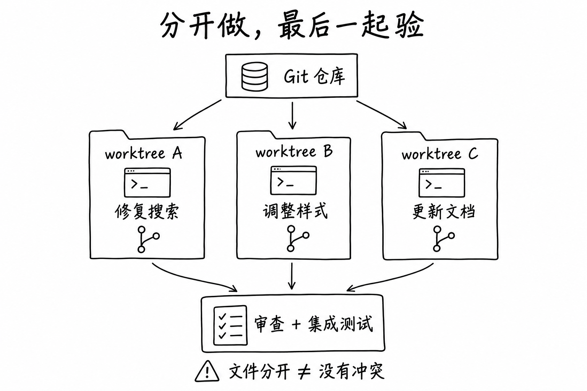
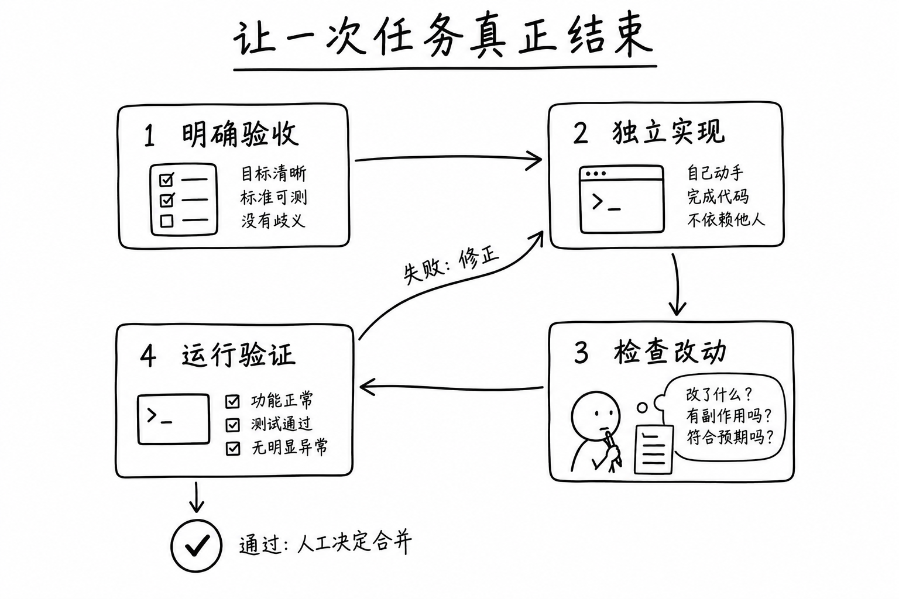

最近注意到 Orca 这个项目，第一眼很容易被“同时运行多个 AI 编程 Agent”吸引。

Claude Code、Codex、OpenCode……把它们摆在一起，各干各的，看起来确实很热闹。但我更想弄明白的是：多开几个终端也能做到的事，为什么值得专门做一个工具？多几个 AI 同时写代码，我究竟会轻松一点，还是要多盯几份作业？

于是我顺着项目和官方文档看了一遍。有个变化值得聊：当 AI 能持续修改一个项目，我们需要操心的事情，也从“这一段代码怎么写”延伸到了“这些任务怎么开始、怎么隔开、怎么收尾”。Orca 正在把这一段流程做成一个工作环境。

这篇就从这里说起。**这是一次基于一手资料的梳理和使用方案设计，还不是长期实测报告。** 后面拿我的博客举例，都是可以尝试的任务设计，不代表我已经用 Orca 跑出了这些成果。

> 资料核对于 2026 年 10 月 16 日。本文的 Orca 指 [stablyai/orca](https://github.com/stablyai/orca)。项目更新很快，界面与实验功能以当前版本为准。

## 先把它放对位置：一个围绕 Agent 工作的开发环境

Orca 把自己称作 ADE，Agent Development Environment。可以理解为：**把编程 Agent、项目工作区、终端和代码审查组织到一起的开发环境。** 官方介绍的基本单位是任务：每项任务可以有自己的 Git worktree、Agent 终端和浏览器标签页。[官方介绍](https://www.onorca.dev/docs)

这里有三层，分清楚以后就不容易误会：

| 层次 | 负责什么 | 例子 |
| --- | --- | --- |
| 模型 | 理解、推理、生成内容 | Agent 背后调用的模型 |
| 编程 Agent | 读取项目、修改文件、执行命令 | Claude Code、Codex、OpenCode |
| 开发环境 | 安放任务、工作区、会话与审查入口 | Orca |

所以，装上 Orca 后，原来那个 Agent 的模型能力不会凭空增强。它改善的是你安排和检查工作的方式。已有 CLI Agent 及其账号、订阅或 API 配置，仍要按对应工具的要求准备。

项目目前以 MIT 许可证开源，提供 macOS、Windows、Linux 桌面版本；仓库列出了多种 CLI Agent 支持。**Orca 应用本身免费，不等于背后的模型调用免费。** 具体消耗仍取决于你接入的 Agent 和服务方案。[项目仓库](https://github.com/stablyai/orca)

如果你现在只偶尔让 AI 改一个函数，现有编辑器或终端很可能已经够用。Orca 更值得考虑的时刻，是你开始频繁遇到这些问题：这个窗口在改哪个分支？刚才那份修改要去哪里看？另一个任务能不能先跑起来？

## 它改变的，是一次任务的组织方式

为了看清这件事，先想一个常见场景：我正在调整博客的文章页，临时又想检查搜索问题，还想整理一篇新文章。

全放进同一个聊天里，任务会互相打断；全放进同一个目录里，两个 Agent 可能同时改文件；手动切分支，又要反复确认哪些内容还没提交。真正让人累的，经常是这些小动作。

### 一个任务，有一张自己的工作台

Git worktree 允许同一个仓库同时拥有多个工作目录，各自检出分支。它们共享仓库的对象和历史等数据，各有自己的工作文件与索引，并不是把整个仓库重新 clone 好几遍。[Git 官方文档](https://git-scm.com/docs/git-worktree)

Orca 把这个能力放进了任务流程：创建工作区时选择起点，把任务放进去，再围绕它打开终端、编辑器和预览。[Worktrees 文档](https://www.onorca.dev/docs/model/worktrees)



*工作方式示意，非 Orca 界面截图。三个任务能否独立推进，仍取决于它们有没有依赖。*

这个设计的价值很朴素：我能先把一项工作安放好，再去做另一项，不必每次都收拾整张桌子。

但“隔离”要讲准确。**文件分开了，合起来是否正确，仍然要检查。** 两个分支可以各自通过检查，合并后却出现问题：一个改了标签格式，另一个还按旧格式读取。Git 甚至可能顺利合并，因为它们没有修改同一行。

还有一些东西根本不在文件隔离的范围内：两个开发服务可能抢同一个端口，两个任务可能连接同一个数据库，也可能写向同一处外部存储。worktree 不能当成安全沙箱；共享或链接的目录也需要单独考虑。

### 反馈可以直接落在改动上

我觉得另一个值得关注的细节，是审查离修改更近了。

Orca 的 Annotate AI Diff 允许在 diff 行上留下意见，然后把一批意见发回 Agent；修改后还能沿着这些评论继续核对。[Annotate AI Diff 文档](https://www.onorca.dev/docs/review/annotate-ai-diff)

这比一句“再检查一下”具体得多。比如：

> 这里生成的链接从 `/` 开始。博客部署在 `/blog/`，请复用现有 URL 工具，并验证从文章页点击和直接刷新这两条路径。

反馈同时包含了位置、原因和验收方式。Agent 有了明确目标，我也知道下一轮该看什么。

这正是我理解的 Orca 的价值：减少任务推进中反复寻找上下文的成本，让“交给 AI”与“拿回来检查”衔接得更顺。

## 多个 Agent，可以怎样一起干活？

“多 Agent”这个词容易把几件不同的事混在一起。

**第一种是并行分工。** 搜索、独立的样式调整、与这些改动无关的文章整理，各有范围，可以同时推进。若文档依赖新功能的最终行为，就得等实现稳定，不能为了并行提前编写答案。

**第二种是同题比较。** 同一个难复现的问题，让两个 Agent 分别分析；或给同一需求尝试两种实现，最后选择更合适的一份。官方入门教程就展示了多 worktree 尝试同一任务的方式。[首次会话教程](https://www.onorca.dev/docs/first-session)

这种做法花费更多，适合“不确定性值得花成本消除”的问题。改一句文案也同时跑三份，收益恐怕很难覆盖我读三遍结果的时间。

**第三种才是带交接的协作。** 谁负责拆解？谁等待谁？结果交到哪里？遇到无法决定的问题找谁？Orca 的 Orchestration 已经涉及 Run、任务、分派、受监督的 worker、消息和决策关卡，但官方目前仍将其标为实验功能，需要单独启用。[Orchestration 文档](https://www.onorca.dev/docs/cli/orchestration)

所以，同时看到三个正在输出的窗口，只能说明它们都在工作。是否形成了有效协作，要看任务之间有没有清楚的契约和交接。

我会先把前两种用顺，再考虑引入更复杂的编排。否则，原本只是修一个问题，最后却先维护起了一套小型项目管理系统。

## 如果今天开始用，我会先做一个很小的实验

我会选一个熟悉、能本地运行、容易判断对错的项目。对我来说，就是这个博客。

### 先确认 Agent 在终端里能正常工作

从 [官方安装页](https://www.onorca.dev/docs/install) 下载系统对应的稳定版。然后在本机终端确认计划接入的 CLI Agent 能启动、认证正常，也能读取一个测试项目。这样出了问题，比较容易分清是 Agent 配置问题，还是 Orca 的工作区问题。

首次尝试先用一个 Agent 就好。同一个 Agent 开两个独立任务，也足够体验工作区组织的变化，不必同时准备多家服务。

### 导入仓库，并确认任务从哪里开始

按照官方教程，用侧栏的 Add Repo 添加本地仓库，通过仓库旁的 `+` 创建工作区，选择起始分支或提交，再选择 Agent。不要跳过起点检查：**主工作目录中尚未提交的修改，不会因为创建 worktree 就自动出现在新任务中。** [首次会话教程](https://www.onorca.dev/docs/first-session)

环境也需要补齐。新 worktree 中通常没有被 Git 忽略的依赖、缓存和本地配置。Orca 提供共享路径与 `.worktreeinclude` 等机制，但第一次我会先明确需要什么，再决定复制或共享；不同依赖版本的任务尤其不宜想当然地共用可写目录。[Worktrees 文档](https://www.onorca.dev/docs/model/worktrees)

拿这个博客来说，先按 README 准备依赖，运行开发服务，确认 `/blog/` 子路径能打开。后续若同时启动多个预览，要明确每个服务对应的工作区和实际端口。看错预览窗口，会把本来正确的验证也变成误判。

### 给出一个边界清楚的任务

第一项实验可以只是检查文章分享区在小屏幕下的布局。我会给这样的提示词：

```text
先阅读 README.md、AGENTS.md、package.json，并查看 git status。

任务：检查文章分享区在 375px 宽度下是否发生横向溢出。
先定位组件并尝试复现；若没有复现，报告检查路径，不为制造成果而修改。

若确认存在问题，只修复相关布局，沿用现有主题变量和样式体系。
不要改文章内容、全局布局、依赖或锁文件，不要提交或推送。

验收：375px、768px、1440px 下无该处横向溢出；
深浅主题、键盘焦点、直接刷新和 Swup 往返正常，路径包含 /blog/。
修改代码后运行 pnpm check、pnpm build。

交付：复现证据、改动原因、验证结果、未完成的检查。
无法执行的检查要说明，不要写成已通过。
```

这里特意保留了“没有复现就不改”。实验的目标是判断任务能不能可靠完成，而不是拿到一份看上去很多的 diff。

### 第二个任务先做独立检查

第一个任务运行时，可以让另一个工作区只检查某篇既有文章的引用链接，列出失效、跳转和无法核实的项，不修改任何文件。这是一次并行分工练习，两项任务无需等待对方的结果。

如果要让第二个 Agent **审查第一个 Agent 的修改**，则必须另外把正确的提交或 diff 交给它。两个从同一起点创建的 worktree，不会自动看到彼此的新改动。让审查者确认自己正在看的提交，比给它加一句“请认真审查”更有用。

### 最后把任务真正关掉



*这是本文建议的工作流程。图中的“独立”指任务边界清楚，不代表可以忽略依赖或跳过交接。*

我会打开 diff，先看有没有超出范围，再核对关键行为和检查结果。对仍有问题的地方留下具体评论，让 Agent 修正；完成后才决定是否提交、合并。

如果两项代码改动都要保留，还需要在集成后的版本上重新验证。各自在旧起点通过一次构建，不能代替合在一起的检查。清理工作区之前，也要确认提交、未跟踪文件和仍需要的素材有没有保存好。

第一次试用，走完这一轮就已经足够。先知道结果在哪里、怎样确认结果，再增加并发数量。

## 怎么知道自己用出了价值，而不只是多消耗了额度？

我会记四件事：

| 观察项 | 具体记录什么 |
| --- | --- |
| 人工投入 | 拆任务、回答追问、审查和修正分别花了多久 |
| 完成质量 | 验收是否通过，有没有遗漏或引入回归 |
| 额外成本 | 任务重复、无效探索、额度消耗与本机资源占用 |
| 交接成本 | 是否看错分支、漏传上下文、等到最后才发现依赖 |

Orca 有使用量和限额展示，但数据来源与支持范围取决于具体服务；这类信息可以帮助安排任务，不能统一当成每次工作的精确账单。[用量文档](https://www.onorca.dev/docs/agents/usage-tracking)

用几个相近规模的任务，对比原来的做法和 Orca 的做法，比盯着窗口里有多少行输出更有参考价值。次数少时不必急着算一个漂亮的提升百分比，先看时间到底花到哪里去了。

假如等待缩短了，我却多花半小时确认三份修改能不能一起用，那么当前的拆分方式就值得调整。反过来，即使总耗时差不多，只要我不再反复寻找分支、丢失会话和复制反馈，也可能已经得到实际收益。

并发数量还受审查能力限制。代码生产得再快，我一天能认真读懂和验证的改动也有限。先开两项边界清楚的任务，往往比把待办一次性全部启动更容易持续。

## 还有哪些用法值得想一想？

下面是基于现有能力的应用设想，尚未在我的项目里验证。

### 给技术选型留一块可丢弃的试验田

例如，同一个交互效果有两种实现思路，可以各自做一个最小原型，用相同的验收条件比较：接入成本、可访问性、清理资源是否完整、维护起来是否容易。

最后不一定要合并任何代码。把选择的依据留下来，也能让下一次决策少绕一点路。这里最重要的是统一比较条件，别让一个方案做演示、另一个方案承担完整生产要求。

### 把视觉反馈变得更具体

Orca 的 Design Mode 可以从真实浏览器窗口里选取元素，把相关 HTML、计算样式和局部截图交给 Agent；源映射可用时还可能附带文件位置。[Design Mode 文档](https://www.onorca.dev/docs/browser/design-mode)

这很适合“这里的留白不对”“这个按钮在手机上太挤”之类的问题。选中元素再说明期望，比来回描述“右边那个区域下面的按钮”省事。但调整完成以后，仍要回到不同尺寸和状态里看，而不只是确认那一张截图变好了。

### 让博客维护有一份持续积累的待办

文章里的外链、安装命令和版本说明都会过时。我会考虑先让 Agent 定期列出疑似失效的引用或过时描述，输出来源和检查时间，再由我决定哪些值得修改。Orca 已提供定时自动化入口，具体运行条件仍需按文档配置。[Scheduled automations 文档](https://www.onorca.dev/docs/cli/automations)

这类任务的第一步应该是可靠地报告问题。只有分清“确定失效”和“这次网络没访问到”，后续自动修改才有讨论价值。

### 离开电脑后，处理一次简短的阻塞

手机端可以配对桌面端，查看 Agent 状态与近期输出、发送后续回复，官方目前标为 Beta。[Mobile companion 文档](https://www.onorca.dev/docs/mobile)

我能想到的价值，是长任务卡在一个小问题上时，可以补充一句信息，让它继续。但复杂代码审查还是要留给合适的屏幕和完整上下文。桌面或执行主机的运行状态、连接情况，也会影响这种用法。

这些设想有一个共同点：先让信息、产物和反馈能够被找到、被复核，再谈自动化程度。

## 我会因为什么留下它？

Orca 让我感兴趣的地方，是它认真对待了 AI 编程里那些不太显眼的环节：工作做到一半怎么放下，另一项任务怎么开始，修改怎样回到人的面前，审查意见怎样准确地送回去。

不过，装上一个新环境，也会多一份配置和维护成本。如果现有工具已经能把这些事情处理好，迁移的理由就应该更具体；如果平时连 diff 都不愿意看，同时运行更多 Agent 只会更难确认结果。

还有一个需要自己判断的边界：本地桌面应用不代表整个处理链路都留在本地。官方遥测文档描述了匿名使用数据及退出方式，Agent 调用模型、手机配对或远程运行又涉及各自的数据路径。涉及工作项目时，应按实际使用方式核对，而不是只看“开源”两个字。[Privacy & Telemetry 文档](https://www.onorca.dev/docs/telemetry)

对我来说，最合适的起点仍然很小：选一个熟悉的仓库，安排两项真正独立的任务，完整走完审查和验证。然后问自己一个具体的问题：**下次做类似的事，我还愿不愿意用这套流程？**

如果答案是愿意，我才会把更多工作搬进去。工具有没有价值，最后总要落回那些普通的下午：少找一会儿窗口，少解释一遍上下文，多完成一件我能放心留下来的事。

---

本文产品事实依据上文链接的一手资料；任务示例、使用建议与应用设想为作者分析。封面及两张图解由 AI 按本文内容生成，采用白底黑笔手绘风格，均为概念示意，不是产品截图。
